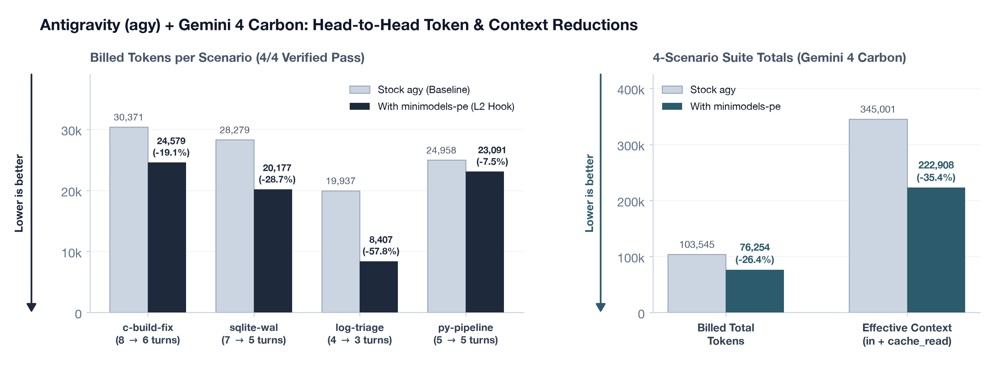
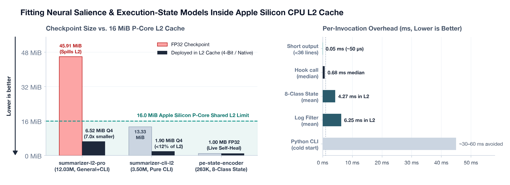

*November 2026*

Coding agents spend a large share of their token budget reading hundreds of repetitive build, test, and server log lines after every shell command, and then re-reading that noise on every turn that follows. Worse, opening an interactive prompt (like Python, SQLite, vim, or a git pager) stalls automated runs and sends the agent into long recovery loops.

To fix both without calling a second LLM or touching the GPU, I built a lightweight plugin for Google Antigravity (agy) powered by two tiny [minimodels](/posts/minimodels-rust-metal.html) neural networks compressed to 2 to 7 MB. Because they are that small, both models sit permanently inside the Mac's 16 MiB CPU L2 cache, running with zero GPU usage and **0.68 ms median hook latency** through small compiled C wrappers.

Before command output ever reaches **Gemini 4 Carbon**, the first model strips routine log boilerplate while keeping every error, warning, stack trace, and distinct log pattern intact, so **passed tasks keep their passing status with zero regressions**. When a command fails or gets stuck, the second model adds a one-line recovery hint and updates its own weights in 32 to 59 ms whenever exit codes disagree with its prediction.

---

## Live Benchmark on Gemini 4 Carbon

<figure class="figure-box">
  
  <figcaption class="figcaption"><strong>Figure 1. Live Head-to-Head Benchmark on Google Antigravity with Gemini 4 Carbon.</strong> Across four engineering scenarios taken from Terminal-Bench 2.1 (4 of 4 pass rate preserved, zero regressions), the L2 plugin cuts billed tokens by 26.4% (103,545 to 76,254, and up to 57.8% on incident log triage) and shrinks cumulative prompt context by 35.4% (345,001 to 222,908).</figcaption>
</figure>

<figure class="figure-box">
  
  <figcaption class="figcaption"><strong>Figure 2. CPU L2 Cache Footprint and Per-Call Latency.</strong> 4-bit compression shrinks checkpoints by 7x with zero accuracy loss, fitting both the 6.52 MiB general filter and a 1.90 MiB CLI-only filter (under 12% of Apple Silicon's 16 MiB L2 cache) alongside the 1.00 MB state model.</figcaption>
</figure>

I ran eight automated Antigravity sessions in isolated sandboxes comparing stock agy against agy with the L2 plugin across four debugging and incident triage tasks from **Terminal-Bench 2.1**: a noisy multi-module C build fix, SQLite WAL and lock recovery, 1,200-line compressed microservice log triage, and a broken Python batch pipeline. Each run was graded by deterministic exit-code and output checks.

Every passing task kept its passing status (**4 of 4 passed, 100% pass rate preserved**), even with up to **76.1%** of tool output text stripped. On full Docker **Terminal-Bench 2.1** runs, the same CPU L2 filter also kept every solved task passing while cutting token usage by **43% to 68%**.

### Suite Summary

| Metric | Stock agy | agy + L2 Plugin | Change |
| :--- | ---: | ---: | ---: |
| **Verified Task Pass Rate** | **4 / 4 (100%)** | **4 / 4 (100%)** | **0 regressions (all passed tasks stay PASS)** |
| **Billed Total Tokens** | 103,545 | **76,254** | **-26.4% (-27,291 tokens)** |
| **Effective Context Tokens (input + cached)** | 345,001 | **222,908** | **-35.4% (-122,093 tokens)** |
| **LLM Planner Turns** | 24 | **19** | **-20.8% (-5 turns)** |
| **Tool Output Chars Stored in Transcript** | 91,983 | **29,013** | **-68.5% (281,214 raw chars stripped)** |
| **Median Hook Overhead / Total Plugin Time** | N/A | **0.68 ms / 0.40 s** | Under 0.2% of total runtime |

### Per-Task Breakdown

| Scenario (Terminal-Bench 2.1) | Arm | Pass | Turns | Billed Tokens | Effective Context | Stored Tool Chars | Wall Time (s) | Chars Stripped |
| :--- | :--- | :---: | ---: | ---: | ---: | ---: | ---: | ---: |
| **1. Noisy C Build Fix** | Baseline | PASS | 8 | 30,371 | 117,024 | 29,199 | 88.55 | 0 |
| **1. Noisy C Build Fix** | **L2 Plugin** | **PASS** | **6** | **24,579 (-19.1%)** | **75,966 (-35.1%)** | **11,537 (-60.5%)** | **60.21 (-32.0%)** | **76,723** |
| **2. SQLite Lock & WAL Recovery** | Baseline | PASS | 7 | 28,279 | 101,902 | 26,524 | 63.37 | 0 |
| **2. SQLite Lock & WAL Recovery** | **L2 Plugin** | **PASS** | **5** | **20,177 (-28.7%)** | **57,959 (-43.1%)** | **7,297 (-72.5%)** | **63.32 (-0.1%)** | **28,762** |
| **3. Microservice Log Triage** | Baseline | PASS | 4 | 19,937 | 53,719 | 11,376 | 38.29 | 0 |
| **3. Microservice Log Triage** | **L2 Plugin** | **PASS** | **3** | **8,407 (-57.8%)** | **30,468 (-43.3%)** | **2,715 (-76.1%)** | 47.25 | **138,403** |
| **4. Python Pipeline & Env Bug** | Baseline | PASS | 5 | 24,958 | 72,356 | 24,884 | 51.15 | 0 |
| **4. Python Pipeline & Env Bug** | **L2 Plugin** | **PASS** | **5** | **23,091 (-7.5%)** | **58,515 (-19.1%)** | **7,464 (-70.0%)** | 65.95 | **37,326** |

- **57.8% fewer billed tokens on 1,200-line log triage (Scenario 3)**: Filtering 138,403 characters of compressed log output in 11.9 ms left a 2,715-character summary with all three root-cause IDs intact, dropping billed tokens from 19,937 to **8,407**.
- **32.0% faster C build debugging (Scenario 1)**: Surfacing the exact compiler and unit-test failures helped the agent patch both C bugs in one pass, finishing in 6 turns instead of 8 (**60.21s vs. 88.55s**).
- **Half as many shell calls on SQLite recovery (Scenario 2)**: A single lock-and-permission hint prompted the agent to clear the stale lockfile and fix read-only database permissions in one step instead of six (-28.7% tokens, -43.1% context).

---

## Takeaways

- **Passed tasks stay passed**: Because the filter reaches 100% critical-error recall (99.75% log accuracy) and always keeps errors, stack traces, and command head/tail lines, stripping 60% to 76% of noisy output preserved 100% of passing runs across both the Antigravity suite (4 of 4) and Docker Terminal-Bench 2.1 tasks.
- **Filter once on the way in to preserve cloud prefix caches**: Stripping log noise before command output is saved leaves earlier turns untouched, preserving Gemini 4 Carbon's cloud prefix cache (67.2% to 74.1% cache hit rate) instead of invalidating cached history on every step.
- **Cloud TPUs vs. local GPUs**: On Cloud TPUs, prompt prefill takes around 100 ms, so filtering cuts token spend (26% to 58%) while saved turns cut runtime (-32% on Scenario 1). On a local Mac Studio GPU running Qwen3.8-27B on Docker Terminal-Bench 2.1, the same CPU L2 filter cuts both tokens (43% to 68%) and wall-clock time (31% to 40%).
- **Small enough for CPU L2**: Training specifically on CLI and DevOps tool output shrinks the log filter to **1.90 MiB**, under 12% of Apple Silicon's 16 MiB P-core L2 cache.
