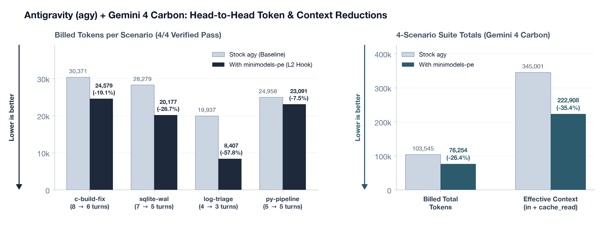
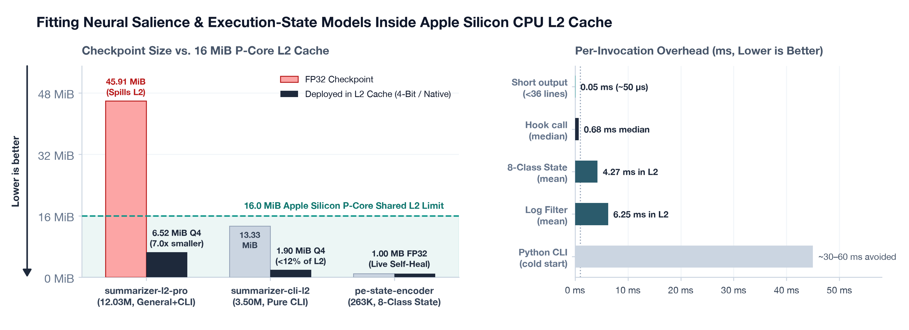

*November 2026*

Coding agents burn a huge share of their context window and token budget reading machine-generated boilerplate. Run a multi-module C build, a verbose `pytest` suite, a database migration, or a compressed microservice log dump, and thousands of routine status lines enter the conversation history. Because that history only grows, every compiler status line or health-check log printed on turn 1 gets re-read on every turn after it. Worse, a single bare `python3`, `sqlite3`, `vim`, or paged `git log` command stalls an automated shell session until timeout, sending the agent into multi-turn recovery loops.

Simple `head` or `tail` truncation loses the actual compiler error or stack trace buried at line 412 of a 1,200-line log. Sending noisy logs to a second LLM call adds hundreds of milliseconds to seconds of latency and wastes the tokens we were trying to save.

Over the past week I built `minimodels-pe`, a native plugin for Antigravity (`agy`) that solves both problems inside the **CPU's L2 cache** before noisy output ever reaches the agent's transcript.

Using 4-bit model compression and ARM integer vector math, two small [`minimodels`](/posts/minimodels-rust-metal.html) neural networks stay pinned inside Apple Silicon's **`16.0 MiB` shared P-core L2 cache** (`~5 ns` latency, zero GPU contention), fronted by two tiny compiled C wrappers (`0.68 ms` median hook latency; `~50 µs` passthrough on short outputs).

Evaluated head-to-head on the `agy` CLI with **Gemini 4 Carbon** (`gemini-4-carbon-low`) across four end-to-end debugging and incident-triage tasks, `minimodels-pe` passed **4 / 4 (100%)** verified benchmarks while cutting **billed tokens by 26.4%** overall (**up to 57.8%** on 1,200-line `.log.gz` triage), **effective prompt context by 35.4%**, **planner turns by 20.8%**, and **stored tool-output text by 68.5%**.

<figure class="figure-box">
  
  <figcaption class="figcaption"><strong>Figure 1. Live Head-to-Head Benchmark on Antigravity (<code>agy</code>) with Gemini 4 Carbon (<code>gemini-4-carbon-low</code>).</strong> Across 4 verified engineering scenarios (<code>4/4</code> pass rate), <code>minimodels-pe</code> cuts billed tokens by <code>26.4%</code> (<code>103,545</code> &rarr; <code>76,254</code>, up to <code>-57.8%</code> on incident log triage) and shrinks cumulative prompt context by <code>35.4%</code> (<code>345,001</code> &rarr; <code>222,908</code>).</figcaption>
</figure>

<figure class="figure-box">
  
  <figcaption class="figcaption"><strong>Figure 2. Apple Silicon <code>16.0 MiB</code> P-Core L2 Cache Residency &amp; Hook Latency.</strong> 4-bit compression shrinks checkpoints by <code>7&times;</code> with zero accuracy loss—fitting both the <code>12.03M</code>-parameter <code>summarizer-l2-pro</code> (<code>6.52 MiB</code>) and CLI-only <code>3.50M</code> <code>summarizer-cli-l2</code> (<code>1.90 MiB</code>, under <code>12%</code> of L2) alongside the <code>1.00 MB</code> 8-class state model, while native C wrappers keep median hook overhead at <code>0.68 ms</code>.</figcaption>
</figure>

---

## 1. Fitting Neural Encoders Inside Apple Silicon's 16 MiB P-Core L2 Cache

On Apple Silicon (both M5 laptops and M5 Ultra workstations), the performance-core cluster shares a **`16.0 MiB` L2 cache** (`sysctl hw.perflevel0.l2cachesize = 16777216`), while each P-core holds a private `128 KiB` L1 data cache. As long as a neural network's weights stay comfortably below `16 MiB`, all P-cores in the cluster can score log lines in parallel from that shared L2 cache at `~5 ns` latency—without touching main memory and without competing with the GPU.

In standard 32-bit or 16-bit floating point, a capable multi-layer transformer encoder blows past that limit. Our `12.03M`-parameter log-salience model (`summarizer-l2-pro`, `4` layers, `width=192`, `heads=6`, `ff=384`, distilled from `ModernBERT-base`) takes **`45.91 MiB` in FP32** and **`22.96 MiB` in FP16**. Both spill out of L2 into main memory.

### 7× Compression via SPECTRA 4-Bit Weights + Sparse 16-Bit Outliers

To fit our `.mm` checkpoints inside L2 without losing accuracy, we built a small C inference library (`minimodel_pe_l2.c`) that combines **SPECTRA mixed-precision 4-bit compression** with ARM hardware integer dot products across CPU cores:

1. **Keeping Top Outliers in 16-Bit Float**: Transformer weight rows often contain one or two unusually large weights; scaling the whole row around them ruins precision for the remaining 99.5%. At load time, we pull out the top two largest weights per row into small 16-bit float arrays (`outlier_idx` + `outlier_val`) before quantizing the rest.
2. **4-Bit Block Quantization (`Q4`)**: The remaining weights are packed as 4-bit signed integers (`[-8, 7]`, two weights per byte) with one 16-bit scale factor per 32 weights (`~4.51 bits/weight` effective).
3. **Hardware Integer Dot Products**: Input activations are quantized per 32-element group into fast L1 buffers. Each inner loop unpacks 32 weights in CPU registers, runs two 16-way integer dot-product instructions, and adds back the exact 16-bit outlier products:

```c
float acc = xm[o_idx0] * o_val0 + xm[o_idx1] * o_val1;
for (size_t g = 0; g < n_groups; g++) {
    uint8x16_t packed = vld1q_u8(w_row + g * 16);
    int8x16_t w_lo = vsubq_s8(vreinterpretq_s8_u8(vandq_u8(packed, vmask)), vzero);
    int8x16_t w_hi = vsubq_s8(vreinterpretq_s8_u8(vshrq_n_u8(packed, 4)), vzero);
    const int8_t *xg = xq + g * 32;
    int32x4_t isum = vdupq_n_s32(0);
    isum = vdotq_s32(isum, w_lo, vld1q_s8(xg));
    isum = vdotq_s32(isum, w_hi, vld1q_s8(xg + 16));
    acc += (float)vaddvq_s32(isum) * ((float)s_row[g] * xs[g]);
}
```

This shrinks checkpoints by **`7.04×`** with **0.0% accuracy loss** and **`2.06×` to `5.0×` faster CPU execution**.

### Specialization: General+CLI (`6.52 MiB`) vs. Pure-CLI (`1.90 MiB`)

Next, we tested how much model size we could save by narrowing the training distribution. Every log line is scored into four classes (`Noise/Boilerplate` to drop, `Background/Context`, `KeyFact/Decision` to keep, and `CriticalAction/Blocker` to prioritize):

- **`summarizer-l2-pro.mm` (`12.03M` params, General + CLI)**: Trained on both general documents (email threads, postmortems, legal/financial text) and CLI logs. Shrinks from `45.91 MiB` FP32 &rarr; **`6.52 MiB` Q4** (`41%` of L2), hitting **`99.75%` CLI log accuracy**, **`100.0%` critical-error recall**, and **`99.0%` unseen-domain accuracy** at `15,097 lines/s`.
- **`summarizer-cli-l2.mm` (`3.50M` params, `3L, w=64, ff=192`, Pure CLI/DevOps)**: Coding agents do not need corporate email greetings or Slack prose in their weight budget. Training purely on compiler output, test runners, database logs, package managers, and microservice traces lets a `3.50M`-parameter model shrink from `13.33 MiB` FP32 &rarr; **`1.90 MiB` Q4**—using **under `12%` of the `16 MiB` L2 cache** while reaching **`100.0%` validation accuracy**, **`99.75%` held-out log accuracy**, and **`100.0%` critical-error recall** at **`~126,000 lines/s`**.

| Checkpoint Variant | Architecture | FP32 Size | 4-Bit L2 Size | Share of `16 MiB` L2 | Validation Acc | Held-Out CLI Log Acc | Critical-Error Recall |
| :--- | :--- | ---: | ---: | ---: | ---: | ---: | ---: |
| **`summarizer-l2-pro`** *(General + CLI)* | `4L, w=192, ff=384` (`12.03M`) | `45.91 MiB` *(spills)* | **`6.52 MiB`** | `40.8%` | `100.0%` | **`99.75%`** | **`100.0%`** |
| **`summarizer-cli-l2`** *(Pure CLI/DevOps)* | `3L, w=64, ff=192` (`3.50M`) | `13.33 MiB` | **`1.90 MiB`** | **`11.9%`** | **`100.0%`** | **`99.75%`** | **`100.0%`** |
| **`pe-state-encoder`** *(8-Class State)* | `4L, w=64` (`263K`) | **`1.00 MB`** | `~0.15 MiB` | `6.0%` *(FP32)* | `100.0%` | **`100.0%`** | **`100.0%`** |

### Paired 8-Class Execution State Model + Live Self-Healing (`32–59 ms`)

Paired alongside the log filter in L2 is `pe-state-encoder.mm` (`263K` parameters, `1.00 MB`), which reads the command and head/tail output of each shell step and classifies execution state in **`4.27 ms` mean** across 8 outcomes—such as `CLEAN_PROGRESS`, `INTERACTIVE_TRAP`, `BUILD_OR_TEST_FAILURE`, `RESOURCE_LOCK_OR_PERMISSION_ERROR`, and `READY_FOR_VERIFICATION`.

Because its `1.00 MB` weights stay directly editable in memory, the model can **self-heal live** when ground truth contradicts a prediction. For example, if a test script exits `0` with `ALL TELEMETRY TESTS PASSED` while the model predicts `BUILD_OR_TEST_FAILURE`, `minimodels learn` runs 3–8 quick gradient steps in **`32–59 ms`** and reloads the updated weights on the spot. Across our 4-scenario `agy` benchmark, it self-healed 4 times in the first three runs and needed **zero** updates by Scenario 4.

---

## 2. Hooking Into `agy` Under 1 Millisecond

Antigravity plugins run hooks as external shell commands around each tool call and model turn. Two simple choices keep `minimodels-pe` fast and unobtrusive:

- **Tiny C wrappers instead of cold-starting Python (`0.68 ms` median)**: Spawning a Python process on every hook adds `30–60 ms` of startup lag. Instead, two small C binaries (`agy-pe-hook` and `agy-pe-filter`) talk over a local Unix socket to a persistent background process that keeps both models hot in L2 cache. Short command outputs (`< 36` lines) pass straight through in C in **`~50 µs`** without even touching the socket.
- **Filter once before saving, nudge only when needed**: Because `agy`'s post-command hook is read-only, the pre-command hook blocks interactive hangs (`vim`, `less`, bare `python3` or `sqlite3` prompts), turns off git pagers, and pipes noisy build/test/log commands through `agy-pe-filter` (preserving the original command's exit code). Deduplication and L2 neural scoring strip routine log chatter *before* `agy` saves the step to the session transcript—keeping 100% of errors, tracebacks, and assertions intact. Before the next model call, the 8-class state model checks the outcome and injects a one-line `[Prompt Enhancer — State: ...]` hint **only** when action is needed, adding **zero** tokens on clean progress turns.

---

## 3. Live Benchmark on Gemini 4 Carbon (`gemini-4-carbon-low`)

We ran eight automated `agy` sessions in isolated sandboxes comparing stock `agy` (`baseline`) against `agy` + `minimodels-pe` (`pe-hook`) on **Gemini 4 Carbon** (`gemini-4-carbon-low`), graded by deterministic exit-code and output checks:

1. **`noisy-c-build-fix`**: Fix two C bugs hidden inside a noisy 14-module, 380-line compiler and unit-test build log.
2. **`sqlite-lock-wal-recovery`**: Recover a settlement script blocked by a stale `.lock` file and read-only SQLite permissions, then fix a refund sign bug.
3. **`noisy-microservice-log-triage`**: Triage a 1,200-line (`140 KB`) compressed `.log.gz` incident dump across `auth`, `worker`, and `gateway` services into `incident_report.json`.
4. **`python-pipeline-env-and-bug`**: Replace a missing CLI tool using Python's standard library `gzip` module and fix an empty-bucket division-by-zero bug.

### Suite Summary (`4 / 4` Verified Pass)

| Metric | Stock `agy` (`baseline`) | `agy` + `minimodels-pe` (`pe-hook`) | Delta |
| :--- | ---: | ---: | ---: |
| **Verified Task Pass Rate** | **4 / 4 (100%)** | **4 / 4 (100%)** | **0 regressions** |
| **Billed Total Tokens** | `103,545` | **`76,254`** | **`-26.4%` (`-27,291` tok)** |
| **Effective Context Tokens (`input + cached`)** | `345,001` | **`222,908`** | **`-35.4%` (`-122,093` tok)** |
| **LLM Planner Turns** | `24` | **`19`** | **`-20.8%` (`-5` turns)** |
| **Tool Output Chars Stored in Transcript** | `91,983` | **`29,013`** | **`-68.5%` (`281,214` raw log chars stripped)** |
| **Median Hook Overhead / Total Plugin Time** | — | **`0.68 ms` / `0.40 s` total** | `< 0.2%` of total runtime |

### Per-Scenario Breakdown

| Scenario | Arm | Pass | Turns | Billed Tokens | Effective Context | Stored Tool Chars | Wall Time (s) | L2 Chars Stripped |
| :--- | :--- | :---: | ---: | ---: | ---: | ---: | ---: | ---: |
| **1. `noisy-c-build-fix`** | `baseline` | PASS | `8` | `30,371` | `117,024` | `29,199` | `88.55` | `0` |
| **1. `noisy-c-build-fix`** | **`pe-hook`** | **PASS** | **`6`** | **`24,579` (`-19.1%`)** | **`75,966` (`-35.1%`)** | **`11,537` (`-60.5%`)** | **`60.21` (`-32.0%`)** | **`76,723`** |
| **2. `sqlite-lock-wal-recovery`** | `baseline` | PASS | `7` | `28,279` | `101,902` | `26,524` | `63.37` | `0` |
| **2. `sqlite-lock-wal-recovery`** | **`pe-hook`** | **PASS** | **`5`** | **`20,177` (`-28.7%`)** | **`57,959` (`-43.1%`)** | **`7,297` (`-72.5%`)** | **`63.32` (`-0.1%`)** | **`28,762`** |
| **3. `noisy-microservice-log-triage`** | `baseline` | PASS | `4` | `19,937` | `53,719` | `11,376` | `38.29` | `0` |
| **3. `noisy-microservice-log-triage`** | **`pe-hook`** | **PASS** | **`3`** | **`8,407` (`-57.8%`)** | **`30,468` (`-43.3%`)** | **`2,715` (`-76.1%`)** | `47.25` | **`138,403`** |
| **4. `python-pipeline-env-and-bug`** | `baseline` | PASS | `5` | `24,958` | `72,356` | `24,884` | `51.15` | `0` |
| **4. `python-pipeline-env-and-bug`** | **`pe-hook`** | **PASS** | **`5`** | **`23,091` (`-7.5%`)** | **`58,515` (`-19.1%`)** | **`7,464` (`-70.0%`)** | `65.95` | **`37,326`** |

- **Scenario 3 (`-57.8%` billed tokens)**: Stripping `138,403` characters of routine log lines in `11.9 ms` left a crisp `2,715`-character digest with all three root-cause IDs, cutting billed tokens from `19,937` to **`8,407`**.
- **Scenario 1 (`-32.0%` wall-clock time)**: Highlighting the exact C build and test failures helped the agent read the right files in parallel, patch both bugs at once, and finish in `6` turns instead of `8` (**`60.21s` vs. `88.55s`**).
- **Scenario 2 (`50%` fewer shell calls)**: A single `RESOURCE_LOCK_OR_PERMISSION_ERROR` nudge prompted the agent to clear the stale lockfile and `chmod u+w` the database in one command instead of six separate shell probes (`-28.7%` billed tokens, `-43.1%` context).

---

## 4. Cloud Prefix Caching vs. Local GPU Prefill

All C hooks and L2 model passes combined took just **`0.40s` across the entire 4-task suite**. Why, then, does L2 filtering save `26%–58%` of tokens on Cloud APIs while wall-clock speedups show up mainly when turns drop (Scenario 1's `-32%`), whereas on a local GPU server the exact same filter cuts *both* tokens and wall-clock time on every noisy task?

1. **Filtering on ingestion protects cloud prefix caching (`67.2%` hit rate)**: Cloud APIs like Gemini 4 Carbon serve earlier conversation turns from prefix cache—but only if past turns never change. If a plugin goes back and edits older turns on every step, it invalidates the prefix cache and forces expensive re-processing. Filtering noisy command output *once before it is saved* keeps history append-only, preserving **`67.2%` cached context hits** overall and lifting Scenario 3's cache hit rate from `64.0%` to **`74.1%`**.
2. **Cloud TPU prefill is ~free in time; local GPU prefill is expensive**:

| Backend | How Prompt History Is Processed | What L2 Filtering Saves |
| :--- | :--- | :--- |
| **Cloud TPU API** (`agy` + `gemini-4-carbon-low`) | Prior turns hit prefix cache; `5k–15k` new tokens prefill across TPU pods in `~100 ms`, while each network/decode turn takes `9–15s` | **Immediate `-26%` to `-58%` token savings** and **`-35%` smaller context**; wall-clock wins (`-32%`) come from saving model round-trips |
| **Local GPU** (`Qwen3.8-27B` via `vllm-mlx` on Mac Studio) | Local unified memory re-processes long prompt history at `~400–600 tok/s` (`25–35s` per noisy turn) | **Saves both tokens (up to `-68.1%`, `434k` &rarr; `139k`) and wall-clock time (`-31%` to `-40%`)** in `~150 ms` of CPU L2 work |

> [!IMPORTANT]
> **Rule of Thumb for Cloud Coding Agents**: Strip tool noise *once on the way in* so earlier turns stay untouched and prefix-cached. Save history rewriting for rare `/compact` checkpoints near context limits.

---

## 5. Takeaways

1. **Apple Silicon's `16 MiB` L2 cache can run capable neural filters with zero GPU cost.** With 4-bit compression, a `12.03M`-parameter log filter fits in `6.52 MiB` and a CLI-only `3.50M` filter fits in **`1.90 MiB`** (`< 12%` of L2) at `99.75%` accuracy and `100%` critical-error recall.
2. **Compiled C shims keep synchronous CLI hooks under a millisecond.** Two tiny C wrappers around a warm background model process keep hook latency at **`0.68 ms` median** and short-output passthrough at **`~50 µs`**, avoiding `30–60 ms` Python cold starts.
3. **Append-only filtering works with cloud prefix caches instead of breaking them.** Cleaning command output before it enters history cuts Gemini 4 Carbon billed tokens by **`26.4%`–`57.8%`** and context size by **`35.4%`** while keeping **`67.2%`–`74.1%`** of prompt tokens served from cache.
