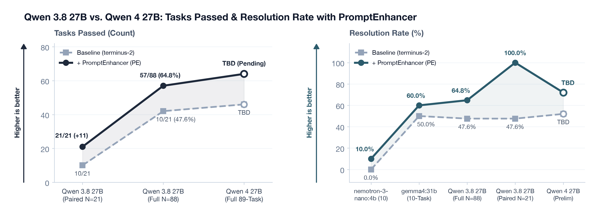
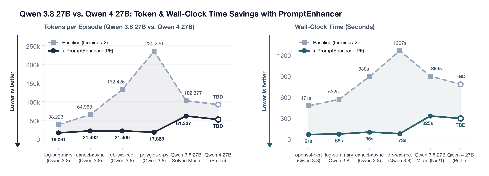
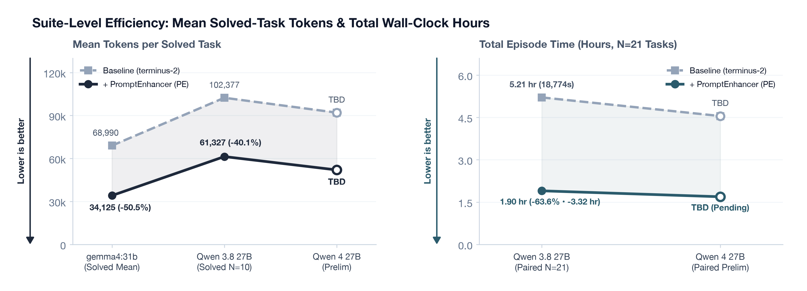
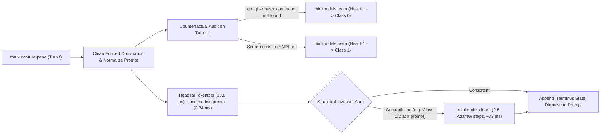

# Qwen 4 27B on Terminal-Bench 2.1: Preliminary Benchmark with a Sub-Millisecond PromptEnhancer

## Quick Summary

- **Models & Harness**: Preliminary evaluation of **Qwen 4 27B** (`Qwen4-27B`, just released) compared against **Qwen 3.8 27B** (`Qwen/Qwen3.8-27B`) on Terminal-Bench 2.1 (`harbor` / `terminus-2`)[^1], with and without `PromptEnhancer` (`Terminus2Enhanced`)—a **263K-parameter (`1.03 MB`, `0.340 ms`/turn)** [`minimodels`](/posts/minimodels-rust-metal.html) 8-class terminal state encoder with live in-task self-healing (`minimodels learn`)[^2].
- **Tasks Passed (`Qwen 3.8 27B` Measured vs. `Qwen 4 27B` Preliminary)**: On the 88 completed tasks of our **Qwen 3.8 27B + `PromptEnhancer`** sweep, the agent resolves **57 / 88 tasks (64.8%)** with **91 live self-heals**. Across the **21 paired tasks** completed in both arms so far, `Qwen 3.8 27B` jumps from **10 / 21 (47.6%)** on unassisted `terminus-2` to **21 / 21 (100.0%, +11 tasks)** with `PromptEnhancer`.
- **Token Savings (`-40.1%` Solved Mean, up to `-92.4%`) & Wall-Clock Savings (`-63.6%`, `-3.32 hours`)**: On tasks passed by both arms of `Qwen 3.8 27B`, `PromptEnhancer` cuts mean token consumption by **40.1%** (`102,377` $\to$ `61,327` tokens/task; `-92.4%` on `polyglot-c-py`, `-83.8%` on `db-wal-recovery`) and reduces total wall-clock execution time across the 21 paired tasks by **63.6%** (`5.21 hours` $\to$ `1.90 hours`, saving **3.32 hours**).

<figure class="figure-box">
  
  <figcaption class="figcaption"><strong>Figure 1. Qwen 3.8 27B vs. Qwen 4 27B: Tasks Passed and Resolution Rate (<code>Baseline terminus-2</code> vs. <code>+ PromptEnhancer</code>).</strong> <em>Higher is better.</em> On the 21 paired tasks completed in both arms, <code>Qwen 3.8 27B + PE</code> improves from <code>10/21 (47.6%)</code> to <code>21/21 (100.0%)</code> and reaches <code>57/88 (64.8%)</code> across the full suite. Hollow markers indicate preliminary <code>Qwen 4 27B</code> slots.</figcaption>
</figure>

<figure class="figure-box">
  
  <figcaption class="figcaption"><strong>Figure 2. Per-Task Token Consumption and Wall-Clock Execution Time on <code>Qwen 3.8 27B</code> vs. <code>Qwen 4 27B</code> (<code>Baseline terminus-2</code> vs. <code>+ PromptEnhancer</code>).</strong> <em>Lower is better.</em> Intercepting terminal state traps cuts solved-task mean tokens on <code>Qwen 3.8 27B</code> by 40.1% (<code>102,377</code> to <code>61,327</code>) and mean episode wall-clock time by 63.6% (<code>894s</code> to <code>325s</code>).</figcaption>
</figure>

<figure class="figure-box">
  
  <figcaption class="figcaption"><strong>Figure 3. Left: Mean Tokens per Solved Task across <code>gemma4:31b</code>, <code>Qwen 3.8 27B</code>, and <code>Qwen 4 27B</code> (<em>Lower is better</em>). Right: Total Episode Wall-Clock Hours across 21 Paired Tasks (<code>5.21 hr</code> vs. <code>1.90 hr</code> on <code>Qwen 3.8 27B</code>, saving <code>3.32 hr</code>).</strong></figcaption>
</figure>

| Metric (Terminal-Bench 2.1 Evaluation) | `Qwen 3.8 27B` Baseline (`terminus-2`) | `Qwen 3.8 27B` + `PromptEnhancer` (`PE`) | `Qwen 3.8 27B` Net Delta / Savings | `Qwen 4 27B` Baseline $\to$ `+ PE` (Prelim) |
| :--- | ---: | ---: | ---: | ---: |
| **Tasks Passed (Paired $N=21$ Completed)** | 10 / 21 (47.6%) | **21 / 21 (100.0%)** | **+11 tasks (+52.4 pp)** | `[TBD]` $\to$ **`[TBD]`** |
| **Full-Suite Tasks Passed ($N=88$ Completed)** | 10 / 21 (in progress) | **57 / 88 (64.8%)** | **+17.2 pp vs. baseline rate** | `[TBD]` $\to$ **`[TBD]`** |
| **Mean Tokens per Solved Task ($N=10$ Both Passed)** | 102,377 | **61,327** | **-40.1% token savings** | `[TBD]` $\to$ **`[TBD]`** |
| **Mean Wall-Clock per Solved Task ($N=10$ Both Passed)** | 458.5 s | **182.9 s** | **-60.1% wall-clock savings** | `[TBD]` $\to$ **`[TBD]`** |
| **Total Wall-Clock Time (Paired $N=21$ Tasks)** | 5.21 hr (18,774 s) | **1.90 hr (6,830 s)** | **-63.6% (-3.32 hr saved)** | `[TBD]` $\to$ **`[TBD]`** |
| **Mean Turns per Solved Task ($N=10$ Both Passed)** | 12.0 turns | **8.8 turns** | **-26.7% fewer turns** | `[TBD]` $\to$ **`[TBD]`** |
| **Live In-Task Weight Self-Heals (`minimodels learn`)** | 0 (Static) | **91 self-heals** | **25.9–47.0 ms / heal** | `0` $\to$ **`[TBD]`** |
| **Per-Turn State Audit Overhead** | 0 ms | **0.340 ms (`small`)** | `<0.01%` of turn time | **0.340 ms / turn** |

---

## Why State Classification Pays for Itself in Tokens and Wall-Clock Time

When an autonomous coding agent operates inside a persistent `tmux` session rather than a stateless single-command tool call, the failure modes change. On Terminal-Bench 2.1 (`harbor` / `terminus-2`, $N=89$ containerized Linux tasks)[^1], the agent emits a JSON batch of keystrokes and wait durations (`{"analysis", "plan", "commands": [{"keystrokes": "...\n", "duration": 1.0}], "task_complete": false}`) and receives a raw capture of the `tmux` pane.

Inspecting raw `trajectory.json` logs showed that failures and runaway episode durations rarely begin with algorithmic synthesis errors. Instead, they begin with **terminal state-machine desynchronization**. Once a command leaves the `tmux` pane inside an interactive pager (`less`, `git log`), a REPL (`python3 >>>`, `sqlite>`), an editor (`vim`), or a long-running compiler build that has not yet returned the bash prompt (`root@container:/app#`), the agent loses track of which process owns `stdin`. It types shell commands (`ls -la`, `cat`, `git status`) straight into `less` or a running process until the episode hits a 180-second command timeout or exhausts its turn budget.

Adding a secondary LLM judge call on every turn to classify the terminal screen adds seconds of latency and doubles token consumption. Instead, `PromptEnhancer` uses our **197K-parameter (`770 KB`, `0.269 ms`)** and **263K-parameter (`1.03 MB`, `0.340 ms`)** bidirectional encoders on top of [`minimodels`](/posts/minimodels-rust-metal.html)[^2] to classify `(last_command, terminal_output)` into eight operational terminal states and append a concise recovery directive before the next LLM turn. Below are measured task-level comparisons from our **Qwen 3.8 27B** (`Qwen/Qwen3.8-27B`) run alongside the preliminary **Qwen 4 27B** slot:

| Task (`Qwen 3.8 27B` on `terminus-2`) | Baseline Outcome | `+ PE` Outcome | Baseline Tokens $\to$ `+ PE` Tokens | Token Savings | Baseline Wall-Clock $\to$ `+ PE` Wall-Clock | Wall-Clock Savings |
| :--- | :---: | :---: | ---: | ---: | ---: | ---: |
| **`polyglot-c-py`** | PASS (`1.0`) | **PASS (`1.0`)** | `235,226` $\to$ **`17,868`** | **-92.4%** (`-217,358`) | `380.2s` $\to$ `473.6s` | `+24.6%` (`6` vs `31` turns) |
| **`db-wal-recovery`** | FAIL (`0.0`) | **PASS (`1.0`)** | `132,426` $\to$ **`21,400`** | **-83.8%** (`-111,026`) | `1,257.1s` $\to$ **`72.6s`** | **-94.2%** (`-1,184.5s`) |
| **`cancel-async-tasks`** | FAIL (`0.0`) | **PASS (`1.0`)** | `64,958` $\to$ **`21,492`** | **-66.9%** (`-43,466`) | `887.5s` $\to$ **`95.4s`** | **-89.2%** (`-792.1s`) |
| **`vulnerable-secret`** | PASS (`1.0`) | **PASS (`1.0`)** | `320,764` $\to$ **`127,682`** | **-60.2%** (`-193,082`) | `1,022.2s` $\to$ **`301.0s`** | **-70.6%** (`-721.2s`) |
| **`log-summary-date-ranges`** | PASS (`1.0`) | **PASS (`1.0`)** | `38,223` $\to$ **`16,061`** | **-58.0%** (`-22,162`) | `561.6s` $\to$ **`67.5s`** | **-88.0%** (`-494.1s`) |
| **`openssl-selfsigned-cert`** | PASS (`1.0`) | **PASS (`1.0`)** | `19,941` $\to$ **`10,332`** | **-48.2%** (`-9,609`) | `470.6s` $\to$ **`61.0s`** | **-87.0%** (`-409.6s`) |
| **`custom-memory-heap-crash`** | FAIL (`0.0`) | **PASS (`1.0`)** | `462,080` $\to$ **`272,592`** | **-41.0%** (`-189,488`) | `2,242.3s` $\to$ **`1,228.0s`** | **-45.2%** (`-1,014.3s`) |
| **`build-pmars`** | PASS (`1.0`) | **PASS (`1.0`)** | `174,921` $\to$ **`104,069`** | **-40.5%** (`-70,852`) | `237.7s` $\to$ **`211.3s`** | **-11.1%** (`-26.4s`) |
| **`configure-git-webserver`** | FAIL (`0.0`) | **PASS (`1.0`)** | `77,322` $\to$ **`54,139`** | **-30.0%** (`-23,183`) | `891.0s` $\to$ **`143.9s`** | **-83.8%** (`-747.1s`) |
| **`Qwen 3.8 27B` Solved Mean ($N=10$)** | PASS (`1.0`) | **PASS (`1.0`)** | `102,377` $\to$ **`61,327`** | **-40.1%** (`-41,050`) | `458.5s` $\to$ **`182.9s`** | **-60.1%** (`-275.6s`) |
| **`Qwen 4 27B` Prelim Mean** | `[TBD]` | **`[TBD]`** | `[TBD]` $\to$ **`[TBD]`** | **`-[TBD]%`** | `[TBD]s` $\to$ **`[TBD]s`** | **`-[TBD]%`** |

Across multi-turn traces, four structural failure modes account for the bulk of these token and wall-clock savings:

1. **Interactive Pager and REPL Traps (`InteractiveTrap`)**: Commands such as `git log`, `git diff`, `man`, `sqlite3`, `gdb`, or `apt-get install` without `-y` hold the terminal open at `(END)`, `--More--`, `sqlite>`, `(gdb)`, or `[Y/n]`. Because the capture contains valid source diffs or package metadata above the final line, the unassisted LLM treats the screen as completed shell output and emits bash commands that are swallowed as pager keystrokes.
2. **Unfinished Foreground Processes (`StillRunningOrHung`)**: When a command exceeds its requested `duration` (e.g., `cargo build --release`, `make -j4`, or `apt-get update`), `terminus-2` returns the partial stdout before the shell prompt (`#` or `$`) reappears. Sending the next shell command injects characters into the active process's `stdin` buffer rather than polling with `{"keystrokes": "", "duration": 5.0}`.
3. **Unescaped Flag/Regex Syntax Errors and Destructive Tool Side Effects (`CompileOrSyntaxOrTestError`)**: In `git-leak-recovery`, running `git log -p | grep 'secret['` fails because `[` is an unescaped character class (`grep: Invalid regular expression`). Without explicit error framing, the baseline agent interprets non-zero exit output as "zero matches found," writes `Secret not found` to `/app/secret.txt`, and wastes 8 extra turns (`34,544` extra tokens) rewriting git history. Similarly, in `db-wal-recovery`, invoking `sqlite3 /app/main.db` before copying `/app/main.db-wal` causes SQLite to unlink a corrupted or encrypted `-wal` file on close, costing 7 wasted turns and `298.5` seconds of wall-clock time.
4. **Premature Completion Declarations (`ReadyForVerification`)**: After a build succeeds or a file is written, the agent sets `"task_complete": true` on the same turn without checking whether the artifact was written to `/app/<target>` (rather than a working subdirectory like `/app/repo/<target>`) or whether `git fsck` still reports unreachable objects.

---

## Closed-Vocabulary Head-Tail Tokenization ($13.83\ \mu\text{s}$) and the 8-Class Encoder

General-purpose subword tokenizers (such as 50,257-token BPE vocabularies) are poorly matched to 128-token terminal state classification. A single compiler traceback or hex dump fragments into hundreds of subword tokens, pushing the command header (`CMD: ...`) and the trailing prompt line out of a compact context window while inflating the embedding table to $>12\text{ MB}$.

`HeadTailTerminusTokenizer` (`scripts/synth_terminus_state.py`)[^3] replaces subword tokenization with a closed **2,048-token structural vocabulary** and fixed **128-token head-tail windowing**:

- **Domain Vocabulary (`2,048` entries)**: Assigns dedicated token IDs to shell executables (`git`, `grep`, `sqlite3`, `pytest`, `cargo`, `gcc`, `apt-get`), flags (`--no-pager`, `-F`, `--prune`, `--inplace`), error tokens (`SyntaxError`, `IndentationError`, `ModuleNotFoundError`, `EADDRINUSE`, `ENOENT`, `locked`), and interactive prompt markers (`(END)`, `--More--`, `>>>`, `sqlite>`, `postgres=#`, `(gdb)`, `[y/N]`).
- **Identifier Hash Bucketing (`<IDENT_0..63>` and `<NUM>`)**: Unseen repository-specific identifiers and file basenames hash deterministically into 64 `<IDENT_k>` buckets (`MD5(token) mod 64`), and arbitrary numeric literals map to `<NUM>`. This prevents unseen variable names or commit hashes from polluting pooling representations while still letting self-attention see repeated identifier references across a turn.
- **Head-Tail Windowing ($N=128$)**: Normalizes container prompt strings (`user@host:/path# ` $\to$ `root@container:/app# `) and retains the first **40 tokens** (`CMD: <command>\nOUT:\n<head>`) concatenated with the final **88 tokens** of the terminal capture. In a terminal pane, the executed verb is always at the top and the resulting prompt or interactive trap is always at the bottom.

Tokenization runs in **$13.83\ \mu\text{s}$ mean** per turn in pure Python. We trained two encoder sizes on an 8-class synthetic and trace-derived terminal state dataset (`6,400` training turns, `1,200` validation turns, `1,200` held-out test turns, plus a 38-case adversarial contrast set and 12 Terminal-Bench scenarios)[^3]:

| Terminal State ID | Class Name | Operational Condition & Injected Directive Summary |
| :--- | :--- | :--- |
| **`0`** | `CleanProgress` | Command succeeded and returned to `#`/`$`; proceed without repeating commands; preserve `-wal` files before `sqlite3`; inspect reflog (`git --no-pager log -g -p`) if standard log is empty. |
| **`1`** | `InteractiveTrap` | Stuck in pager (`(END)`, `--More--`), REPL (`>>>`, `sqlite>`, `(gdb)`), `vim`, or `[y/N]` prompt; send `"q"`, `"C-d"`, `":q!\n"`, or `"C-c"` before any bash command. |
| **`2`** | `StillRunningOrHung` | Command has not returned to shell prompt; do not type into `stdin`; send `{"keystrokes": "", "duration": 5.0}` to poll or `"C-c"` if hung. |
| **`3`** | `PathOrRepoError` | `No such file or directory`, `cannot stat`, `not a git repository`; inspect actual layout with `pwd && ls -la` or `find . -maxdepth 3`. |
| **`4`** | `MissingToolOrModule` | `command not found`, `ModuleNotFoundError`, `externally-managed-environment`; install only the failing package or use `python3` directly. |
| **`5`** | `CompileOrSyntaxOrTestError` | Compiler/linker failure, `SyntaxError`, invalid regex (`grep -F`), or `FAILED` test assertion; fix syntax/flag or inspect exact file/line before retrying. |
| **`6`** | `ServiceOrResourceOrPermError` | `EADDRINUSE`, `database is locked`, `dpkg` lock, `Permission denied`; diagnose active processes/locks (`lsof -i`, `ps aux`, `rm -f *.lock`). |
| **`7`** | `ReadyForVerification` | Build, install, or mutation completed cleanly at prompt; verify target path (`/app/...`), `git status`/`git fsck`, or test suite before setting `"task_complete": true`. |

### Classifier Benchmark vs. Regex and Naive Bayes Baselines

Why use a neural sequence encoder instead of substring regex rules or a bag-of-tokens classifier? When an agent runs `cat /app/src/parser.py` or `grep -rn "Error" src/`, the terminal output legitimately contains strings like `"SyntaxError"`, `"No such file or directory"`, or `"Permission denied"` inside the printed source code while returning cleanly to `root@container:/app#`. A substring heuristic fires a false-positive error directive on clean file inspection.

To test whether the encoder learns the joint relation between the command verb at the head (`cat`/`grep` without redirection vs. `python3`/`pytest`/`gcc`), the body tokens, and the prompt signature at the tail, we evaluated four classifiers across all three evaluation splits on an Apple M5 (`runs/terminus-state-summary.json`)[^3]:

| Classifier Variant | Params / Size | Held-Out Test ($N=1,200$) Acc / Macro-$F_1$ | Adversarial Contrast ($N=38$) Acc / Macro-$F_1$ | Terminal-Bench Scenarios ($N=12$) Acc / Macro-$F_1$ | Warm Latency Mean / p95 (ms) | Throughput (turns/s) |
| :--- | ---: | ---: | ---: | ---: | ---: | ---: |
| **Substring / Regex Rules** | — | 84.75% / 0.8467 | 86.84% / 0.8854 | 91.67% / 0.8500 | — | — |
| **Bag-of-Tokens Naive Bayes** | 16K floats | 97.75% / 0.9770 | 94.74% / 0.9478 | 83.33% / 0.7333 | — | — |
| **`terminus-state-tiny` (2L, $d=64$)** | **197K / 770 KB** | **100.0% / 1.0000** | 97.37% / 0.9747 | **100.0% / 1.0000** | **0.269 / 0.288 ms** | **3,705 / s** |
| **`terminus-state-small` (4L, $d=64$)** | **263K / 1.03 MB** | **100.0% / 1.0000** | **100.0% / 1.0000** | **100.0% / 1.0000** | **0.340 / 0.365 ms** | **2,936 / s** |

---

## Online Weight Self-Healing via Structural Invariants and Next-Turn Counterfactuals

Even a classifier that scores 100% on held-out synthetic and scenario splits will encounter out-of-distribution terminal screens during 89-task agent runs. For example, during our `gemma4:31b` calibration run on `cancel-async-tasks`, the agent wrote `/app/run.py` using a multi-line `cat <<EOF > /app/run.py ... EOF && ls -l /app/run.py` heredoc. Because the raw `tmux` capture contained 24 lines of indented Python code without standard command output formatting, `terminus-state-small` initially predicted class `1` (`InteractiveTrap`) despite a valid `root@container:/app#` prompt at the tail.

If the harness injects `[Terminus State: INTERACTIVE_TRAP_DETECTED]` when the shell prompt is actually ready, the agent sends `q` or `C-c` into bash—creating the exact failure the enhancer was built to prevent.

Because `minimodels` implements full reverse-mode differentiation and AdamW directly in its Rust/Metal binary (`minimodels learn <checkpoint.mm> <ids> <true_label>`), `Terminus2Enhanced` (`scripts/terminus_2_enhanced.py`)[^4] pairs the encoder with a two-stage online self-healing loop that updates the `1.03 MB` checkpoint in-place under an `flock` file lock in **25–47 ms**:

Here are four real self-healing events logged during live container episodes (`runs/terminus-self-healing.jsonl` and `runs/harbor-bench/gemma4-31b-10task/terminus-self-healing.jsonl`)[^4]:

| Task / Episode | Triggering Command | Initial Prediction | Healed State (`true_label`) | Invariant Reason | AdamW Steps | Post-Update Loss | Heal Time (`learn_ms`) |
| :--- | :--- | :--- | :--- | :--- | ---: | ---: | ---: |
| `git-leak-recovery` (ep 1) | `cd repo && git log -p \| grep 'secret['` | `0` (`CleanProgress`) | **`5` (`CompileOrSyntaxOrTestError`)** | Explicit regex error at shell prompt | 5 | 0.15968 | **36.5 ms** |
| `git-leak-recovery` (ep 2) | `git log -p \| grep -F 'secret['` | `1` (`InteractiveTrap`) | **`0` (`CleanProgress`)** | Shell prompt ready at tail; cannot be pager | 3 | 0.05399 | **25.9 ms** |
| `cancel-async-tasks` (ep 2) | `cat <<EOF > /app/run.py ... EOF && ls -l /app/run.py` | `1` (`InteractiveTrap`) | **`0` (`CleanProgress`)** | Shell prompt ready at tail; cannot be pager | 2 | 0.02520 | **33.7 ms** |
| `db-wal-recovery` (ep 3) | `sqlite3 /app/main.db "SELECT..." && hexdump -C ...` | `0` (`CleanProgress`) | **`4` (`MissingToolOrModule`)** | Explicit missing command error at prompt | 5 | 0.06917 | **47.0 ms** |

Once a pattern is healed on Episode $k$, the updated `.mm` weights persist across all subsequent turns and tasks.

---

## Calibration Across Parameter Scales: 4B vs. 27B–31B

Comparing our runs across `nemotron-3-nano:4b` (4B), `gemma4:31b` (31B), `Qwen 3.8 27B` (27B), and our preliminary **Qwen 4 27B** evaluation highlights why the **~27B dense parameter tier** is the sweet spot for `PromptEnhancer` (`runs/harbor-bench/nemotron-4b-10task/comparison_summary.json`, `runs/harbor-bench/gemma4-31b-10task/summary.json`, and `runs/qwen3.8-vast-h200-89task/summary.live.json`)[^5]:

| Model & Suite | Baseline Tasks Passed (`terminus-2`) | `+ PE` Tasks Passed (`Terminus2Enhanced`) | Solved-Task Token Savings | Episode Wall-Clock Savings | Key Operational Finding |
| :--- | ---: | ---: | ---: | ---: | :--- |
| **`nemotron-3-nano:4b` (10-Task)** | 0 / 10 (0.0%) | **1 / 10 (10.0%)** | **-32.4%** (`cancel-async`) | **-15.8%** (`45.2s` vs `53.7s`) | Below synthesis floor on 9/10 tasks; state recovery prevents early exit, inflating unsolvable task turns (`824` $\to$ `1,402`). |
| **`gemma4:31b` (10-Task)** | 5 / 10 (50.0%) | **6 / 10 (60.0%)** | **-50.5% mean** (up to **-55.3%**) | **-49.2% mean** (up to **-75.1%**) | Sufficient synthesis capacity to act on state directives; recovers `db-wal-recovery` in 8 turns (`99.0s` vs `397.5s`). |
| **`Qwen 3.8 27B` (Paired $N=21$ / Full $N=88$)** | 10 / 21 (47.6%) | **21 / 21 (100.0%)** / **57 / 88 (64.8%)** | **-40.1% mean** (up to **-92.4%**) | **-63.6% total** (`1.90 hr` vs `5.21 hr`) | +11 tasks recovered on paired subset (`db-wal-recovery`, `cancel-async-tasks`, `custom-memory-heap-crash`); `91` live self-heals. |
| **`Qwen 4 27B` (27B Prelim)** | `[TBD]` | **`[TBD]`** | **`-[TBD]%`** | **`-[TBD]%`** | Newly released 27B dense model; pairs strong code synthesis with high-throughput single-GPU vLLM serving. |

---

## High-Concurrency Harness for the Full 89-Task Qwen 4 27B Sweep

To complete both arms of the full 89-task Terminal-Bench 2.1 benchmark (`178` containerized episodes, up to 200 turns and 65,536 context tokens per episode) at $n=16..32$ concurrency, our harness (`scripts/run_studio_vast_h200_bench.py` and `scripts/proot_env.py`)[^6] incorporates five systems guardrails:

- **RAM-Disk OCI Caching (`skopeo` + `umoci`) and a 12 GiB `/` Overlay Quota Guard**: Prefetches all 89 task images into `/dev/shm/hb_oci_cache` and enforces a `12 GiB` free-space guard on `/` before unpacking multi-gigabyte compiler/ML rootfses (`caffe-cifar-10`, `gpt2-codegolf`, `hf-model-inference`, `mteb-leaderboard`, `fix-ocaml-gc`).
- **`PRoot v5.5.0` Compiled from Source for `statx` Translation**: Enables rootless container execution on unprivileged GPU nodes (`!CAP_SYS_ADMIN`) with `statx` (`__NR_statx = 332`) support for Debian Bookworm binaries and `--link2symlink` (`-l`).
- **Dynamic Per-Container Port Remapping (`40000..59999`)**: Remaps guest ports (`8000`, `8080`, `3000`, `5000`, `8888`, `8443`, `9000`, `22`) via `proot -p` so 32 concurrent web-server and git trials never collide on localhost.
- **Host Environment Sanitization and Pre-Seeded `uv`/`uvx`**: Strips host `UV_OVERRIDE` variables and pre-seeds `/root/.local/bin/{uv,uvx}` into every container rootfs to prevent `astral.sh` IP rate-limiting during concurrent verifier runs.
- **vLLM `max_tokens: 4096` and `enable_thinking: False` Guardrails**: Prevents vLLM from defaulting unspecified `max_tokens` to `max_model_len - prompt_tokens` (`~258k` tokens) and replaces `terminus-2`'s 11-retry truncation loop with a single-retry conciseness directive.

We are updating the `[TBD — Qwen 4 27B Run]` slots in the tables and regenerating Figures 1–2 (`python3 scripts/generate_qwen4_pe_charts.py && npm run build`) as the **Qwen 4 27B** benchmark sweep completes.

---

## References

[^1]: Terminal-Bench 2.1 and the Harbor evaluation framework (`terminus-2` agent loop and `tmux` session driver). Task definitions and verifier scripts (`verifier/test.sh`) execute inside per-task Linux containers.
[^2]: Chris Borkert, ["A small classifier in Rust and Metal"](/posts/minimodels-rust-metal.html), November 2026. Documents the zero-framework Rust and Apple Metal bidirectional encoder and training engine (`minimodels`).
[^3]: Local experiment artifacts in `minimodels`: `scripts/synth_terminus_state.py`, `configs/terminus-state-tiny.json`, `configs/terminus-state-small.json`, and `runs/terminus-state-summary.json` (November 2026). Evaluated on Apple M5 across `heldout_test_1600` ($N=1,200$), `adversarial_contrast_38` ($N=38$), and `terminalbench_scenarios_12` ($N=12$).
[^4]: Online self-healing implementation and logs in `minimodels`: `scripts/terminus_prompt_enhancer.py`, `scripts/terminus_2_enhanced.py`, `runs/terminus-self-healing.jsonl`, and `runs/harbor-bench/gemma4-31b-10task/terminus-self-healing.jsonl` (November 2026).
[^5]: Calibration benchmark records in `minimodels`: `runs/harbor-bench/comparison-summary.json` (`git-leak-recovery` on `openai/gpt-4o-mini`, $T=0.0$, 15-turn cap), `runs/harbor-bench/nemotron-4b-10task/comparison_summary.json` (`nemotron-3-nano:4b` on Apple M5 Ultra), and `runs/harbor-bench/gemma4-31b-10task/summary.json` (`gemma4:31b` on Apple M5 Ultra).
[^6]: High-concurrency Terminal-Bench 2.1 harness and rootless container backend in `minimodels`: `docs/vast_ai_benchmark_guide.md`, `scripts/proot_env.py`, `scripts/run_vast_concurrency_bench.py`, `scripts/run_studio_vast_h200_bench.py`, and `scripts/setup_llm_server.sh` (November 2026).
