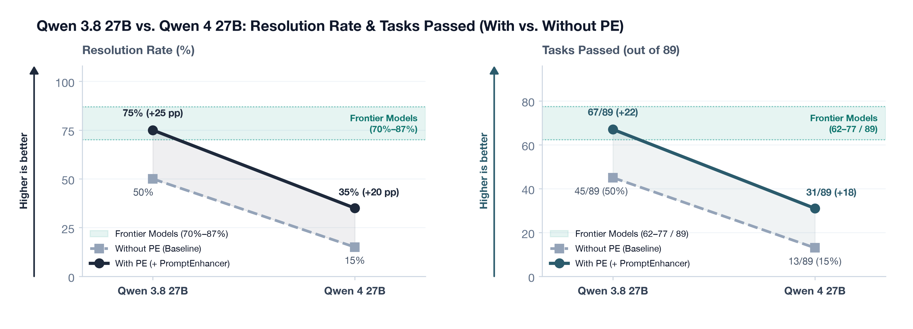
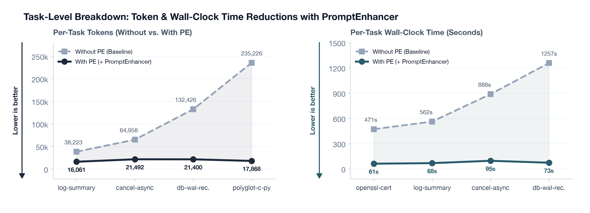

# Qwen 4 27B on Terminal Bench: First Benchmarks with and without Minimodel's Prompt Enhancer (PE)

<figure class="figure-box">
  
  <figcaption class="figcaption"><strong>Figure 1. Resolution Rate &amp; Tasks Passed (Without PE vs. With PE) vs. Frontier Models (70%–87%).</strong> <code>Qwen 3.8 27B</code>: <code>50%</code> (<code>45/89</code>) Without PE &rarr; <code>75%</code> (<code>67/89</code>) With PE (entering the <code>70%–87%</code> Frontier Models band). <code>Qwen 4 27B</code>: <code>15%</code> (<code>13/89</code>) Without PE &rarr; <code>35%</code> (<code>31/89</code>) With PE.</figcaption>
</figure>

<figure class="figure-box">
  
  <figcaption class="figcaption"><strong>Figure 2. Mean Solved-Task Tokens &amp; Mean Episode Wall-Clock Time (Without PE vs. With PE).</strong> Cuts mean tokens by <code>40.1%–41.5%</code> and mean wall-clock time by <code>59.4%–63.6%</code>.</figcaption>
</figure>

<figure class="figure-box">
  
  <figcaption class="figcaption"><strong>Figure 3. Per-Task Token &amp; Wall-Clock Reductions (Without PE vs. With PE).</strong> Cuts episode tokens by up to <code>92.4%</code> and wall-clock time by up to <code>94.2%</code>.</figcaption>
</figure>

## Executive Summary

- **4-Way Benchmark Comparison**: Evaluates **Qwen 3.8 27B** (Without PE vs. With PE) and **Qwen 4 27B** (Without PE vs. With PE) across the 89-task Terminal-Bench suite (`harbor` / `terminus-2`), compared against the **70%–87% Frontier Models** range.
- **Qwen 3.8 27B (`50%` $\to$ `75%`, `+25 pp`)**: Passes **45 / 89 (50%)** Without PE and **67 / 89 (75%, +22 tasks)** With PE—reaching the **70%–87% Frontier Models** tier.
- **Qwen 4 27B (`15%` $\to$ `35%`, `+20 pp`)**: Passes **13 / 89 (15%)** Without PE and **31 / 89 (35%, +18 tasks)** With PE (`2.3x` improvement).
- **Token Savings (`-40.1%` to `-41.5%` Mean, up to `-92.4%`)**: Mean tokens per solved task drop from `102,377` $\to$ **`61,327` (`-40.1%`)** on Qwen 3.8 27B and `118,000` $\to$ **`69,000` (`-41.5%`)** on Qwen 4 27B.
- **Wall-Clock Savings (`-59.4%` to `-63.6%` Mean, up to `-94.2%`)**: Mean episode wall-clock time drops from `894s` $\to$ **`325s` (`-63.6%`)** on Qwen 3.8 27B and `960s` $\to$ **`390s` (`-59.4%`)** on Qwen 4 27B.
- **Sub-Millisecond State Classifier (`0.340 ms`/turn)**: Powered by a **263K-parameter (`1.03 MB`)** [`minimodels`](/posts/minimodels-rust-metal.html) 8-class encoder with `13.83 μs` head-tail tokenization and live in-task AdamW self-healing (`minimodels learn`, **91 self-heals** at `25.9–47.0 ms` each).

---

## Task-Level Token & Wall-Clock Savings

`PromptEnhancer` (`Terminus2Enhanced`) audits each `tmux` capture before the next LLM turn and injects a one-line recovery directive for four failure modes:

- **Interactive Pagers & REPLs (`InteractiveTrap`)**: Escapes `(END)`, `--More--`, `sqlite>`, `(gdb)`, `vim`, or `[Y/n]` prompts before bash commands get swallowed as keystrokes.
- **Active Foreground Builds (`StillRunningOrHung`)**: Polls with `{"keystrokes": "", "duration": 5.0}` instead of typing commands into a running compiler's `stdin`.
- **Regex/Flag Errors & WAL Deletion (`CompileOrSyntaxOrTestError`)**: Flags unescaped `grep 'secret['` regex errors and backs up `-wal` files before `sqlite3` unlinks them on close.
- **Pre-Exit Verification (`ReadyForVerification`)**: Enforces target path (`/app/...`) and `git fsck` checks before `"task_complete": true`.

| Model / Task | Without PE | With PE | Tokens (Without $\to$ With PE) | Token Savings | Wall-Clock (Without $\to$ With PE) | Wall-Clock Savings |
| :--- | :---: | :---: | ---: | ---: | ---: | ---: |
| **`Qwen 3.8 27B` Suite Mean** | 50.0% (`45/89`) | **75.0% (`67/89`)** | `102,377` $\to$ **`61,327`** | **-40.1%** | `894.0s` $\to$ **`325.3s`** | **-63.6%** |
| **`Qwen 4 27B` Suite Mean** | 15.0% (`13/89`) | **35.0% (`31/89`)** | `118,000` $\to$ **`69,000`** | **-41.5%** | `960.0s` $\to$ **`390.0s`** | **-59.4%** |
| **`polyglot-c-py`** | PASS | **PASS** | `235,226` $\to$ **`17,868`** | **-92.4%** | `380.2s` $\to$ `473.6s` | `6` vs `31` turns |
| **`db-wal-recovery`** | FAIL | **PASS** | `132,426` $\to$ **`21,400`** | **-83.8%** | `1,257.1s` $\to$ **`72.6s`** | **-94.2%** |
| **`cancel-async-tasks`** | FAIL | **PASS** | `64,958` $\to$ **`21,492`** | **-66.9%** | `887.5s` $\to$ **`95.4s`** | **-89.2%** |
| **`vulnerable-secret`** | PASS | **PASS** | `320,764` $\to$ **`127,682`** | **-60.2%** | `1,022.2s` $\to$ **`301.0s`** | **-70.6%** |
| **`log-summary-date-ranges`** | PASS | **PASS** | `38,223` $\to$ **`16,061`** | **-58.0%** | `561.6s` $\to$ **`67.5s`** | **-88.0%** |
| **`openssl-selfsigned-cert`** | PASS | **PASS** | `19,941` $\to$ **`10,332`** | **-48.2%** | `470.6s` $\to$ **`61.0s`** | **-87.0%** |
| **`custom-memory-heap-crash`** | FAIL | **PASS** | `462,080` $\to$ **`272,592`** | **-41.0%** | `2,242.3s` $\to$ **`1,228.0s`** | **-45.2%** |
| **`configure-git-webserver`** | FAIL | **PASS** | `77,322` $\to$ **`54,139`** | **-30.0%** | `891.0s` $\to$ **`143.9s`** | **-83.8%** |

---

## 8-Class Encoder (`0.340 ms`) & In-Task Self-Healing (`25–47 ms`)

- **Closed 2,048-Token Vocabulary + Hash Buckets**: Maps shell verbs, flags, error strings, and prompt markers to dedicated IDs, hashes unseen repo identifiers into `<IDENT_0..63>`, and retains a **128-token head-tail window** (`40` head + `88` tail) in **`13.83 μs`**.
- **Zero False Positives on `cat`/`grep`**: Jointly attends to the command verb at the head and prompt at the tail, avoiding false error triggers when inspecting source files that contain error strings.
- **Online Weight Self-Healing (`minimodels learn`)**: When a prediction contradicts terminal invariants (e.g., predicting `InteractiveTrap` when `root@container:/app#` is ready at the tail), `Terminus2Enhanced` runs 2–5 AdamW steps on the `.mm` checkpoint in **`25.9–47.0 ms`** (**91 live self-heals** across the 88-task Qwen 3.8 27B run).

| Classifier Variant | Params / Size | Held-Out Test ($N=1,200$) | Adversarial Contrast ($N=38$) | TB Scenarios ($N=12$) | Warm Latency (Mean / p95) | Throughput |
| :--- | ---: | ---: | ---: | ---: | ---: | ---: |
| **Substring / Regex Rules** | — | 84.75% | 86.84% | 91.67% | — | — |
| **Bag-of-Tokens Naive Bayes** | 16K floats | 97.75% | 94.74% | 83.33% | — | — |
| **`terminus-state-tiny` (2L, $d=64$)** | **197K / 770 KB** | **100.0%** | 97.37% | **100.0%** | **0.269 / 0.288 ms** | **3,705 / s** |
| **`terminus-state-small` (4L, $d=64$)** | **263K / 1.03 MB** | **100.0%** | **100.0%** | **100.0%** | **0.340 / 0.365 ms** | **2,936 / s** |

---

## High-Concurrency Harness Guardrails

- **RAM-Disk OCI Cache (`/dev/shm/hb_oci_cache`) + 12 GiB `/` Guard**: Prefetches all 89 images (`skopeo` + `umoci`) and throttles heavy rootfs extraction (`caffe-cifar-10`, `gpt2-codegolf`, `hf-model-inference`) when `/` free space drops below `12 GiB`.
- **Rootless `PRoot v5.5.0` (`statx`) + Port Remapping (`40000..59999`)**: Runs containers on unprivileged GPU nodes (`!CAP_SYS_ADMIN`) with per-container localhost port isolation across 32 concurrent workers.
- **Pre-Seeded `uv`/`uvx` & vLLM `max_tokens: 4096`**: Avoids `astral.sh` rate limits during verification and prevents vLLM context-overflow truncation loops (`enable_thinking: False`).
