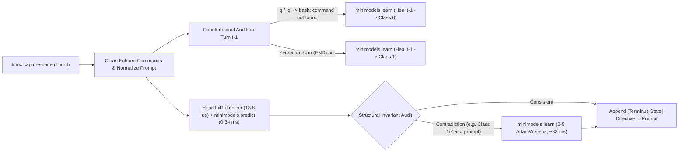

# Sub-Millisecond Terminal State Classification for Coding Agents: Benchmarking PromptEnhancer on Terminal-Bench 2.1 with Qwen 4 27B

*By Chris Borkert · November 2026*

> *Note: The `minimodels` 8-class `PromptEnhancer` encoder, in-task weight self-healing loop, and high-concurrency Terminal-Bench 2.1 execution harness described below are complete and verified on calibration runs. We are holding the full 89-task paired evaluation for **Qwen 4 27B**, which is scheduled for release shortly, and will run and publish the complete 89-task tables as soon as the weights drop.*

When an autonomous coding agent operates inside a persistent `tmux` session rather than a stateless single-command tool call, the failure modes change. On Terminal-Bench 2.1 (`harbor` / `terminus-2`, $N=89$ containerized Linux tasks)[^1], the agent emits a JSON batch of keystrokes and wait durations (`{"analysis", "plan", "commands": [{"keystrokes": "...\n", "duration": 1.0}], "task_complete": false}`) and receives a raw capture of the `tmux` pane.

I initially expected task failures on open-weight models to stem from algorithmic synthesis errors. Inspecting raw `trajectory.json` logs showed a more mechanical problem: **terminal state-machine desynchronization**. Once a command leaves the `tmux` pane inside an interactive pager (`less`, `git log`), a REPL (`python3 >>>`, `sqlite>`), an editor (`vim`), or a long-running compiler build that has not yet returned the bash prompt (`root@container:/app#`), smaller and mid-sized models lose track of which process owns `stdin`. They type shell commands (`ls -la`, `cat`, `git status`) straight into `less` or a running process until the episode hits the turn or timeout limit.

Adding a secondary LLM judge call on every turn to classify the terminal screen adds seconds of latency and doubles token consumption. Instead, I trained a **263,176-parameter (`1.03 MB`)** 4-layer bidirectional encoder (`terminus-state-small`) on top of [`minimodels`](/posts/minimodels-rust-metal.html)—my zero-framework Rust and Metal/CPU engine[^2]—to classify `(last_command, terminal_output)` into eight operational terminal states in **0.340 ms** per turn (`2,936 turns/s` on Apple M5) and append a deterministic recovery directive before the agent's next LLM call.

---

## State-Machine Desynchronization in Persistent tmux Loops

In Harbor's `terminus-2` harness[^1], every turn captures the active `tmux` pane via `capture-pane` and feeds it back to the model as a plain text block prefixed with `New Terminal Output:` or `Current Terminal Screen:`. Across multi-turn traces, four structural failure modes recur:

1. **Interactive Pager and REPL Traps (`InteractiveTrap`)**: Commands such as `git log`, `git diff`, `man`, `sqlite3`, `gdb`, or `apt-get install` without `-y` hold the terminal open at `(END)`, `--More--`, `sqlite>`, `(gdb)`, or `[Y/n]`. Because the capture contains valid source diffs or package metadata above the final line, the LLM treats the screen as completed shell output and emits bash commands that are swallowed as pager keystrokes.
2. **Unfinished Foreground Processes (`StillRunningOrHung`)**: When a command exceeds its requested `duration` (e.g., `cargo build --release`, `make -j4`, or `apt-get update`), `terminus-2` returns the partial stdout before the shell prompt (`#` or `$`) reappears. Sending the next shell command injects characters into the active process's `stdin` buffer rather than waiting with `{"keystrokes": "", "duration": 5.0}`.
3. **Unescaped Flag/Regex Syntax Errors and Destructive Tool Side Effects (`CompileOrSyntaxOrTestError`)**: In `git-leak-recovery`, running `git log -p | grep 'secret['` fails because `[` is an unescaped character class (`grep: Invalid regular expression`). Without explicit error framing, the baseline agent interprets non-zero exit output as "zero matches found," writes `Secret not found` to `/app/secret.txt`, and wastes its remaining turns rewriting git history. Similarly, in `db-wal-recovery`, invoking `sqlite3 /app/main.db` before copying `/app/main.db-wal` causes SQLite to unlink a corrupted or encrypted `-wal` file on close.
4. **Premature Completion Declarations (`ReadyForVerification`)**: After a build succeeds or a file is written, the agent sets `"task_complete": true` on the same turn without checking whether the artifact was written to `/app/<target>` (rather than a working subdirectory like `/app/repo/<target>`) or whether `git fsck` still reports unreachable objects.

---

## Closed-Vocabulary Head-Tail Tokenization ($13.83\ \mu\text{s}$) and the 1.03 MB Encoder

General-purpose subword tokenizers (such as 50,257-token BPE vocabularies) are poorly matched to 128-token terminal state classification. A single compiler traceback or hex dump fragments into hundreds of subword tokens, pushing the command header (`CMD: ...`) and the trailing prompt line out of a compact context window while inflating the embedding table to $>12\text{ MB}$.

`HeadTailTerminusTokenizer` (`scripts/synth_terminus_state.py`)[^3] replaces subword tokenization with a closed **2,048-token structural vocabulary** and fixed **128-token head-tail windowing**:

- **Domain Vocabulary (`2,048` entries)**: Assigns dedicated token IDs to shell executables (`git`, `grep`, `sqlite3`, `pytest`, `cargo`, `gcc`, `apt-get`), flags (`--no-pager`, `-F`, `--prune`, `--inplace`), error tokens (`SyntaxError`, `IndentationError`, `ModuleNotFoundError`, `EADDRINUSE`, `ENOENT`, `locked`), and interactive prompt markers (`(END)`, `--More--`, `>>>`, `sqlite>`, `postgres=#`, `(gdb)`, `[y/N]`).
- **Identifier Hash Bucketing (`<IDENT_0..63>` and `<NUM>`)**: Unseen repository-specific identifiers and file basenames hash deterministically into 64 `<IDENT_k>` buckets (`MD5(token) mod 64`), and arbitrary numeric literals map to `<NUM>`. This prevents unseen variable names or commit hashes from polluting pooling representations while still letting self-attention see repeated identifier references across a turn.
- **Head-Tail Windowing ($N=128$)**: Normalizes container prompt strings (`user@host:/path# ` $\to$ `root@container:/app# `) and retains the first **40 tokens** (`CMD: <command>\nOUT:\n<head>`) concatenated with the final **88 tokens** of the terminal capture. In a terminal pane, the executed verb is always at the top and the resulting prompt or interactive trap is always at the bottom.

Tokenization runs in **$13.83\ \mu\text{s}$ mean** per turn in pure Python. We trained two encoder sizes on an 8-class synthetic and trace-derived terminal state dataset (`6,400` training turns, `1,200` validation turns, `1,200` held-out test turns, plus a 38-case adversarial contrast set and 12 Terminal-Bench scenarios)[^3]:

| Terminal State ID | Class Name | Operational Condition & Injected Directive Summary |
| :--- | :--- | :--- |
| **`0`** | `CleanProgress` | Command succeeded and returned to `#`/`$`; proceed without repeating commands; preserve `-wal` files before `sqlite3`; inspect reflog (`git --no-pager log -g -p`) if standard log is empty. |
| **`1`** | `InteractiveTrap` | Stuck in pager (`(END)`, `--More--`), REPL (`>>>`, `sqlite>`, `(gdb)`), `vim`, or `[y/N]` prompt; send `"q"`, `"C-d"`, `":q!\n"`, or `"C-c"` before any bash command. |
| **`2`** | `StillRunningOrHung` | Command has not returned to shell prompt; do not type into `stdin`; send `{"keystrokes": "", "duration": 5.0}` to poll or `"C-c"` if hung. |
| **`3`** | `PathOrRepoError` | `No such file or directory`, `cannot stat`, `not a git repository`; inspect actual layout with `pwd && ls -la` or `find . -maxdepth 3`. |
| **`4`** | `MissingToolOrModule` | `command not found`, `ModuleNotFoundError`, `externally-managed-environment`; install only the failing package or use `python3` directly. |
| **`5`** | `CompileOrSyntaxOrTestError` | Compiler/linker failure, `SyntaxError`, invalid regex (`grep -F`), or `FAILED` test assertion; fix syntax/flag or inspect exact file/line before retrying. |
| **`6`** | `ServiceOrResourceOrPermError` | `EADDRINUSE`, `database is locked`, `dpkg` lock, `Permission denied`; diagnose active processes/locks (`lsof -i`, `ps aux`, `rm -f *.lock`). |
| **`7`** | `ReadyForVerification` | Build, install, or mutation completed cleanly at prompt; verify target path (`/app/...`), `git status`/`git fsck`, or test suite before setting `"task_complete": true`. |

### Classifier Benchmark vs. Regex and Naive Bayes Baselines

Why use a neural sequence encoder instead of substring regex rules or a bag-of-tokens classifier? When an agent runs `cat /app/src/parser.py` or `grep -rn "Error" src/`, the terminal output legitimately contains strings like `"SyntaxError"`, `"No such file or directory"`, or `"Permission denied"` inside the printed source code while returning cleanly to `root@container:/app#`. A substring heuristic fires a false-positive error directive on clean file inspection.

To test whether the encoder learns the joint relation between the command verb at the head (`cat`/`grep` without redirection vs. `python3`/`pytest`/`gcc`), the body tokens, and the prompt signature at the tail, we evaluated four classifiers across all three evaluation splits on an Apple M5 (`runs/terminus-state-summary.json`)[^3]:

| Classifier Variant | Params / Size | Held-Out Test ($N=1,200$) Acc / Macro-$F_1$ | Adversarial Contrast ($N=38$) Acc / Macro-$F_1$ | Terminal-Bench Scenarios ($N=12$) Acc / Macro-$F_1$ | Warm Latency Mean / p95 (ms) | Throughput (turns/s) |
| :--- | ---: | ---: | ---: | ---: | ---: | ---: |
| **Substring / Regex Rules** | — | 84.75% / 0.8467 | 86.84% / 0.8854 | 91.67% / 0.8500 | — | — |
| **Bag-of-Tokens Naive Bayes** | 16K floats | 97.75% / 0.9770 | 94.74% / 0.9478 | 83.33% / 0.7333 | — | — |
| **`terminus-state-tiny` (2L, $d=64$)** | **197K / 770 KB** | **100.0% / 1.0000** | 97.37% / 0.9747 | **100.0% / 1.0000** | **0.269 / 0.288 ms** | **3,705 / s** |
| **`terminus-state-small` (4L, $d=64$)** | **263K / 1.03 MB** | **100.0% / 1.0000** | **100.0% / 1.0000** | **100.0% / 1.0000** | **0.340 / 0.365 ms** | **2,936 / s** |

The 4-layer `terminus-state-small` checkpoint (`1.03 MB`) separates inspection commands from execution failures across all 38 adversarial contrast pairs and all 12 Terminal-Bench scenario fixtures at **0.340 ms** per turn.

---

## Online Weight Self-Healing via Structural Invariants and Next-Turn Counterfactuals

Even a classifier that scores 100% on held-out synthetic and scenario splits will encounter out-of-distribution terminal screens during 89-task agent runs. For example, during our `gemma4:31b` calibration run on `cancel-async-tasks`, the agent wrote `/app/run.py` using a multi-line `cat <<EOF > /app/run.py ... EOF && ls -l /app/run.py` heredoc. Because the raw `tmux` capture contained 24 lines of indented Python code without standard command output formatting, `terminus-state-small` initially predicted class `1` (`InteractiveTrap`) despite a valid `root@container:/app#` prompt at the tail.

If the harness injects `[Terminus State: INTERACTIVE_TRAP_DETECTED]` when the shell prompt is actually ready, the agent sends `q` or `C-c` into bash—creating the exact failure the enhancer was built to prevent.

Because `minimodels` implements full reverse-mode differentiation and AdamW directly in its Rust/Metal binary (`minimodels learn <checkpoint.mm> <ids> <true_label>`), `Terminus2Enhanced` (`scripts/terminus_2_enhanced.py`)[^4] pairs the encoder with a two-stage online self-healing loop that updates the `1.03 MB` checkpoint in-place under an `flock` file lock in **25–47 ms**:



The online self-healing logic enforces two complementary invariants:

```python
# Invariant pseudocode: per-turn classification + hot weight self-healing
def classify_and_heal(prev_turn, last_cmd, clean_out, timeout_flag):
    # 1. Retrospective counterfactual check on Turn t-1
    if prev_turn and prev_turn.cls == INTERACTIVE_TRAP:
        if last_cmd in {"q", "C-c", ":q!", "exit()"} and "command not found" in clean_out:
            minimodels_learn(prev_turn.ids, true_label=CLEAN_PROGRESS)
    elif prev_turn and prev_turn.cls in {CLEAN_PROGRESS, READY_FOR_VERIFICATION}:
        if clean_out.endswith(("\n:", "(END)")):
            minimodels_learn(prev_turn.ids, true_label=INTERACTIVE_TRAP)

    # 2. Forward prediction + current-turn structural invariant check
    ids = tokenizer.encode_head_tail(last_cmd, clean_out)
    cls = minimodels_predict(checkpoint, ids)
    has_prompt = is_shell_prompt(clean_out.splitlines()[-1])

    audit_cls = audit_ground_truth(last_cmd, clean_out, timeout_flag, has_prompt)
    if audit_cls is not None and audit_cls != cls:
        cls = minimodels_learn(ids, true_label=audit_cls).after_class
    elif has_prompt and cls in {INTERACTIVE_TRAP, STILL_RUNNING}:
        cls = minimodels_learn(ids, true_label=CLEAN_PROGRESS).after_class
    return cls, DIRECTIVES[cls]
```

Here are four real self-healing events logged during live container episodes (`runs/terminus-self-healing.jsonl` and `runs/harbor-bench/gemma4-31b-10task/terminus-self-healing.jsonl`)[^4]:

| Task / Episode | Triggering Command | Initial Prediction | Healed State (`true_label`) | Invariant Reason | AdamW Steps | Post-Update Loss | Heal Time (`learn_ms`) |
| :--- | :--- | :--- | :--- | :--- | ---: | ---: | ---: |
| `git-leak-recovery` (ep 1) | `cd repo && git log -p \| grep 'secret['` | `0` (`CleanProgress`) | **`5` (`CompileOrSyntaxOrTestError`)** | Explicit regex error at shell prompt | 5 | 0.15968 | **36.5 ms** |
| `git-leak-recovery` (ep 2) | `git log -p \| grep -F 'secret['` | `1` (`InteractiveTrap`) | **`0` (`CleanProgress`)** | Shell prompt ready at tail; cannot be pager | 3 | 0.05399 | **25.9 ms** |
| `cancel-async-tasks` (ep 2) | `cat <<EOF > /app/run.py ... EOF && ls -l /app/run.py` | `1` (`InteractiveTrap`) | **`0` (`CleanProgress`)** | Shell prompt ready at tail; cannot be pager | 2 | 0.02520 | **33.7 ms** |
| `db-wal-recovery` (ep 3) | `sqlite3 /app/main.db "SELECT..." && hexdump -C ...` | `0` (`CleanProgress`) | **`4` (`MissingToolOrModule`)** | Explicit missing command error at prompt | 5 | 0.06917 | **47.0 ms** |

Once a pattern is healed on Episode $k$, the updated `.mm` weights persist for all subsequent turns and tasks.

---

## Forensic Trace: Recovering Unreachable Git Objects in 7 Turns vs. 15-Turn Exhaustion

Before scaling to the full 89-task suite, I ran a controlled single-task A/B trace on `terminal-bench/git-leak-recovery` using `openai/gpt-4o-mini` at temperature `0.0` with a 15-turn cap inside an isolated `apple-container` Linux arm64 VM (`runs/harbor-bench/comparison-summary.json`)[^5]. The task requires recovering a leaked secret from an unreachable git commit (`secret[lost_and_found_in_git]`), writing it to `/app/secret.txt`, and purging the secret from all repository objects while preserving good commits.

Both the baseline (`terminus-2`) and enhanced (`Terminus2Enhanced`) agents issued the exact same command on Turn 1:

```bash
cd repo && git log -p | grep 'secret['
```

Because `secret[` contains an unclosed bracket, `grep` exited with `grep: Invalid regular expression`. From Turn 2 onward, the trajectories diverged completely:

- **Baseline `terminus-2` (FAIL, 15 turns, 53,532 tokens)**: On Turn 2, the agent changed its query to `grep 'secret'`, which only searched reachable branch commits and returned nothing. Over Turns 3–8, it inspected reachable commits (`1fea098`, `e897283`) and `git branch -a`. Convinced the secret did not exist, it executed `echo 'Secret not found' > /app/secret.txt` on Turn 9 and spent Turns 10–15 installing and running `git-filter-repo`. It passed 4 of 5 verifier checks but failed `test_flag_file_exists_and_correct`.
- **`Terminus2Enhanced` (PASS, 7 turns, 18,988 tokens)**: On Turn 1, `PromptEnhancer` classified the failed `grep` output as `CompileOrSyntaxOrTestError` (`[Terminus State: BUILD_OR_TEST_FAILURE]`) and directed the agent to escape regex brackets or pass `grep -F`. On Turn 2, `git log -p | grep -F 'secret['` completed cleanly with empty output, triggering `CleanProgress` (`[Terminus State: CLEAN_PROGRESS]`), which prompted the agent to inspect reflog diffs (`git --no-pager log -g -p`) on Turn 3. That immediately exposed the dangling commit containing `secret[lost_and_found_in_git]`. On Turn 4, the agent wrote `/app/secret.txt` and pruned unreachable objects (`git reflog expire --expire=now --all && git gc --prune=now --aggressive`), which the encoder classified as `ReadyForVerification` (`7`), prompting a final `ls -la /app/secret.txt && git status && git fsck` check on Turn 5 before completing.

| Metric (`git-leak-recovery`, $T=0.0$) | `terminus-2` (Baseline) | `Terminus2Enhanced` (`minimodels` 1.03 MB) | Delta |
| :--- | ---: | ---: | ---: |
| **Verifier Outcome (`pytest`)** | **FAIL (0.0 — 4/5 tests)** | **PASS (1.0 — 5/5 tests)** | **+1.0 reward** |
| **Total Turns** | 15 | **7** | **-8 turns (-53.3%)** |
| **Input Tokens (Cached)** | 50,520 (46,208) | **17,652 (13,440)** | **-65.1%** |
| **Output Tokens** | 3,012 | **1,336** | **-55.6%** |
| **Total Tokens** | 53,532 | **18,988** | **-34,544 (-64.5%)** |
| **API Cost (USD)** | $0.00592 | **$0.00244** | **-58.8%** |
| **Enhancer Subprocess Time (mean / call)** | 0 ms (0 calls) | **34.5 ms** (5 calls; 0.34 ms kernel) | +172.6 ms total |

---

## The Capability Floor: 10-Task Calibration on 4B vs. 31B Local Models

To see where external state classification stops helping, I ran a 10-task Terminal-Bench 2.1 calibration subset (`cancel-async-tasks`, `cobol-modernization`, `db-wal-recovery`, `fix-code-vulnerability`, `fix-git`, `git-leak-recovery`, `nginx-request-logging`, `polyglot-c-py`, `regex-log`, `sqlite-db-truncate`) on two local models served on an Apple M5 Ultra (`studio`) with a 200-turn limit and 30-minute per-task timeout (`runs/harbor-bench/nemotron-4b-10task/comparison_summary.json` and `runs/harbor-bench/gemma4-31b-10task/summary.json`)[^5]:

1. **`nemotron-3-nano:4b` (4B parameters)**:
   - **Pass rate**: Baseline scored **0 / 10 (0.0%)**; `Terminus2Enhanced` scored **1 / 10 (10.0%)**, solving `cancel-async-tasks` in 2 turns (`3,568` tokens, `45.2 s`) where baseline failed (`0.0`).
   - **Negative finding (turn inflation on unsolvable tasks)**: Across all 10 tasks, `Terminus2Enhanced` consumed **1,402 total turns (`14.07M` tokens)** versus **824 baseline turns (`8.33M` tokens)**. Why? Without the enhancer, the 4B model frequently emitted malformed JSON or prematurely declared `task_complete: true` after 2–9 turns on tasks it could not solve (`fix-git`, `git-leak-recovery`, `nginx-request-logging`, `regex-log`, `sqlite-db-truncate`). Because `Terminus2Enhanced` recovers from truncation errors, re-injects JSON schema reminders on empty command batches, and blocks premature completion via `ReadyForVerification`, it kept the 4B model alive in the loop for all 200 turns when the model lacked the underlying C, COBOL, or SQLite binary knowledge to solve the task.
2. **`gemma4:31b` (31B parameters)**:
   - **Pass rate**: Baseline scored **5 / 10 (50.0%)**; `Terminus2Enhanced` scored **6 / 10 (60.0%)**, recovering `db-wal-recovery` (`8` turns, `99.0 s`, `32,779` tokens) and `sqlite-db-truncate` where the 31B model had sufficient synthesis capacity to act on the state directives.

| Model (10-Task Calibration Subset) | Baseline Pass Rate (`terminus-2`) | Enhanced Pass Rate (`Terminus2Enhanced`) | Net Task Delta | Online Self-Heals Triggered | Key Observation |
| :--- | ---: | ---: | ---: | ---: | :--- |
| **`nemotron-3-nano:4b`** | 0 / 10 (0.0%) | **1 / 10 (10.0%)** | +1 (`+10.0%`) | 1 | Below capability floor; state recovery prevents early exit, inflating turns (`824` $\to$ `1,402`) on tasks the 4B model cannot synthesize. |
| **`gemma4:31b`** | 5 / 10 (50.0%) | **6 / 10 (60.0%)** | +1 (`+10.0%`) | 3 | Crosses capability threshold; directives + 3 live self-heals recover `db-wal-recovery` and `sqlite-db-truncate`. |

This calibration result motivates our model choice for the full 89-task evaluation: **4B models lack the synthesis floor for multi-step systems debugging, whereas the ~27B–32B dense parameter tier has the code competence to exploit terminal state guidance while remaining fast enough for high-concurrency local or single-GPU serving.**

---

## High-Concurrency Terminal-Bench 2.1 Without Docker: Rootless PRoot and vLLM Guardrails

Running all 89 Terminal-Bench 2.1 tasks across two experimental arms (`178` full container episodes, up to 200 turns and 65,536 context tokens per episode) sequentially at concurrency $n=1$ takes days. To benchmark **Qwen 4 27B** across all 89 tasks within hours of its release at $n=16..32$ concurrency, we built two execution topologies (`docs/vast_ai_benchmark_guide.md`)[^6]:

1. **Hybrid Studio Docker + SSH-Tunneled vLLM (`scripts/run_studio_vast_h200_bench.py`)**: Runs native Docker task containers on `studio` (Apple M5 Ultra) while tunneling OpenAI-compatible vLLM requests (`http://127.0.0.1:18000/v1`) over SSH to a remote H200/H100 GPU instance.
2. **Self-Contained Rootless `ProotEnvironment` on Unprivileged Cloud GPU Containers (`scripts/proot_env.py`)**: Cloud GPU instances (such as Vast.ai H100/H200 nodes) execute inside unprivileged Docker containers (`!CAP_SYS_ADMIN`, `unshare` syscall blocked, no `dockerd` daemon). Standard `harbor run --env docker` fails immediately.

To run 32 concurrent Terminal-Bench containers inside an unprivileged GPU container without `dockerd` or `CAP_SYS_ADMIN`, I implemented a custom Harbor backend, `ProotEnvironment(BaseEnvironment)` (`scripts/proot_env.py`)[^6], solving five operational bottlenecks discovered during bring-up:

- **RAM-Disk OCI Caching (`skopeo` + `umoci`) and a 12 GiB `/` Overlay Quota Guard**: All 89 task images (`~90 GB` total) are prefetched in parallel into `/dev/shm/hb_oci_cache` via `skopeo copy`. Because `/dev/shm` is mounted `noexec`, active rootfses must unpack onto `/tmp/hb_containers/<session_id>` on the `/` overlayfs. While typical task images unpack to `~480 MB`, compiler and ML tasks (`caffe-cifar-10`, `gpt2-codegolf`, `hf-model-inference`, `mteb-leaderboard`, `fix-ocaml-gc`) unpack to `2–6 GB` each. Unpacking 32 large rootfses simultaneously exceeds a standard 64 GB `/` overlay quota and crashes the host instance. `ProotEnvironment.start()` enforces an automatic `12 GiB` free-space guard (`shutil.disk_usage("/")`) that pauses new rootfs extraction until a running trial finishes and deletes its rootfs.
- **`PRoot v5.5.0` Compiled from Source for `statx` Translation**: Ubuntu 22.04's apt package (`proot 5.1.0` from 2018) lacks `statx` syscall translation (`__NR_statx = 332`), causing Debian Bookworm binaries (`ls`, `stat`, `uv`, `uvx`) inside task containers to fail. Compiling `PRoot v5.5.0` from source adds `statx` translation, `--link2symlink` (`-l`, required for `dpkg` hardlinks in `libc6`), and per-container port remapping (`-p`).
- **Dynamic Per-Container Port Remapping (`40000..59999`)**: Concurrent web-server and SSH tasks (`nginx-request-logging`, `pypi-server`, `fix-code-vulnerability`, `configure-git-webserver`, `git-multibranch`) bind to ports `8000`, `8080`, `3000`, `5000`, `8888`, `8443`, `9000`, and `22`. Without network namespaces, 32 concurrent containers collide on localhost ports and conflict with host `jupyter`/`sshd` daemons. `ProotEnvironment` assigns each trial a unique port block in `40000..59999` via `proot -p <guest_port>:<host_port>`.
- **Host Environment Sanitization and Pre-Seeded `uv`/`uvx`**: Host GPU containers inject `UV_OVERRIDE=/etc/uv-overrides.txt`, which breaks `uvx pytest` inside Harbor's `verifier/test.sh`. Furthermore, when 32 trials finish near-simultaneously and run `curl -LsSf https://astral.sh/uv/install.sh`, `astral.sh` rate-limits the shared IP, causing false verifier failures. `ProotEnvironment` strips host `UV_*` variables and pre-seeds `/root/.local/bin/{uv,uvx}` directly into every unpacked rootfs before starting the agent.
- **vLLM `max_tokens` Default Trap on 262k Context Windows**: When vLLM serves a model with `max_model_len = 262144` (or `65536`), any chat completion request that omits an explicit `max_tokens` defaults to `max_model_len - prompt_tokens` (`~258,000` output tokens). A single repetition loop on one turn can stall a GPU worker for 40 minutes generating 250k tokens. `Terminus2Enhanced` explicitly injects `"max_tokens": 4096` and `"chat_template_kwargs": {"enable_thinking": False}` inside `extra_body` on every request, and intercepts `OutputLengthExceededError` with a single-retry conciseness directive (`<80 words`) rather than `terminus-2`'s default 11 consecutive empty retries.

---

## Pre-Registered 89-Task Evaluation Protocol for Qwen 4 27B

With the `PromptEnhancer` checkpoint (`runs/terminus-state-small/epoch-3.mm`, `1.03 MB`), online self-healing loop, and high-concurrency Terminal-Bench 2.1 runner frozen, our next step is the full 89-task evaluation on **Qwen 4 27B** as soon as the model weights are released.

To prevent post-hoc cherry-picking, both arms will run under an identical locked protocol (`scripts/run_studio_vast_h200_bench.py` / `scripts/run_vast_concurrency_bench.py`)[^6]:

- **Dataset**: All **89 tasks** in `terminal-bench@2.1` (`harbor`).
- **Model & Decoding**: **Qwen 4 27B** (`temperature = 0.0`, `max_model_len = 65,536`, `max_tokens = 4,096`, `enable_thinking = False`, `max_turns = 200`).
- **Stage 1 (`Terminus2Enhanced`)**: `terminus-2` subclassed with `TerminusPromptEnhancer` (`terminus-state-small`, 4 layers, width 64, 263K parameters, `1.03 MB`) and live in-task self-healing (`minimodels learn`).
- **Stage 2 (`terminus-2` Baseline)**: Unmodified Harbor `terminus-2` agent against the identical vLLM endpoint and container environment.

### Full 89-Task Terminal-Bench 2.1 Results Matrix (Awaiting Qwen 4 27B Release)

| Evaluation Metric ($N=89$ Tasks, `terminal-bench@2.1`) | Stage 2: Vanilla `terminus-2` (Qwen 4 27B) | Stage 1: `Terminus2Enhanced` + `PromptEnhancer` (Qwen 4 27B) | Paired Delta |
| :--- | :--- | :--- | :--- |
| **Completed Tasks** | *[Pending Qwen 4 27B Release]* / 89 | *[Pending Qwen 4 27B Release]* / 89 | — |
| **Verified Pass Count (`reward == 1.0`)** | *[Pending Qwen 4 27B Release]* | *[Pending Qwen 4 27B Release]* | *[Pending]* |
| **Overall Pass Rate (%)** | *[Pending Qwen 4 27B Release]* | *[Pending Qwen 4 27B Release]* | *[Pending]* |
| **Median Turns per Solved Task** | *[Pending Qwen 4 27B Release]* | *[Pending Qwen 4 27B Release]* | *[Pending]* |
| **Total Tokens Consumed (Input + Output)** | *[Pending Qwen 4 27B Release]* | *[Pending Qwen 4 27B Release]* | *[Pending]* |
| **Interactive Pager / REPL Traps Recovered** | *[Pending Qwen 4 27B Release]* | *[Pending Qwen 4 27B Release]* | *[Pending]* |
| **Live In-Task Weight Self-Heals (`minimodels learn`)** | 0 (Static baseline) | *[Pending Qwen 4 27B Release]* | — |
| **Mean `PromptEnhancer` Latency per Turn** | 0 ms | **0.340 ms** (warm Metal kernel) / **~33 ms** (CLI subprocess) | — |

The two questions this 89-task run will answer are:
1. Does a `1.03 MB`, sub-millisecond structural state classifier materially lift full-suite Terminal-Bench 2.1 pass rates on a 27B dense model, or do the gains concentrate only in specific failure categories (interactive pagers, git reflog recovery, SQLite WAL handling, and build verification)?
2. Does online weight self-healing (`minimodels learn` across episodes) monotonically reduce state-classification errors over the course of an 89-task sweep without introducing class drift on later tasks?

As soon as **Qwen 4 27B** is available, I will run both 89-task stages and update the table above with the full task-by-task breakdown, failure traces, and self-healing logs.

---

## References

[^1]: Terminal-Bench 2.1 and the Harbor evaluation framework (`terminus-2` agent loop and `tmux` session driver). Task definitions and verifier scripts (`verifier/test.sh`) execute inside per-task Linux containers.
[^2]: Chris Borkert, ["A small classifier in Rust and Metal"](/posts/minimodels-rust-metal.html), November 2026. Documents the zero-framework Rust and Apple Metal bidirectional encoder and training engine (`minimodels`).
[^3]: Local experiment artifacts in `minimodels`: `scripts/synth_terminus_state.py`, `configs/terminus-state-tiny.json`, `configs/terminus-state-small.json`, and `runs/terminus-state-summary.json` (November 2026). Evaluated on Apple M5 across `heldout_test_1600` ($N=1,200$), `adversarial_contrast_38` ($N=38$), and `terminalbench_scenarios_12` ($N=12$).
[^4]: Online self-healing implementation and logs in `minimodels`: `scripts/terminus_prompt_enhancer.py`, `scripts/terminus_2_enhanced.py`, `runs/terminus-self-healing.jsonl`, and `runs/harbor-bench/gemma4-31b-10task/terminus-self-healing.jsonl` (November 2026).
[^5]: Calibration benchmark records in `minimodels`: `runs/harbor-bench/comparison-summary.json` (`git-leak-recovery` on `openai/gpt-4o-mini`, $T=0.0$, 15-turn cap), `runs/harbor-bench/nemotron-4b-10task/comparison_summary.json` (`nemotron-3-nano:4b` on Apple M5 Ultra), and `runs/harbor-bench/gemma4-31b-10task/summary.json` (`gemma4:31b` on Apple M5 Ultra).
[^6]: High-concurrency Terminal-Bench 2.1 harness and rootless container backend in `minimodels`: `docs/vast_ai_benchmark_guide.md`, `scripts/proot_env.py`, `scripts/run_vast_concurrency_bench.py`, `scripts/run_studio_vast_h200_bench.py`, and `scripts/setup_llm_server.sh` (November 2026).
